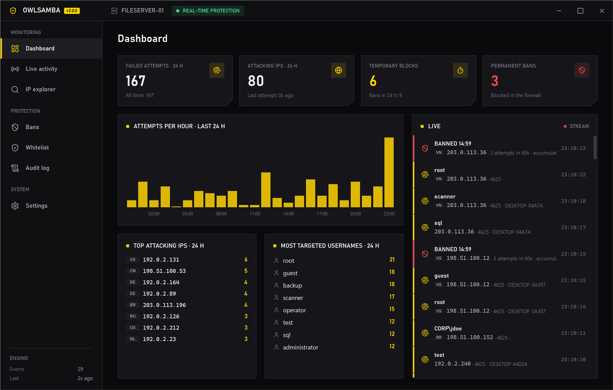
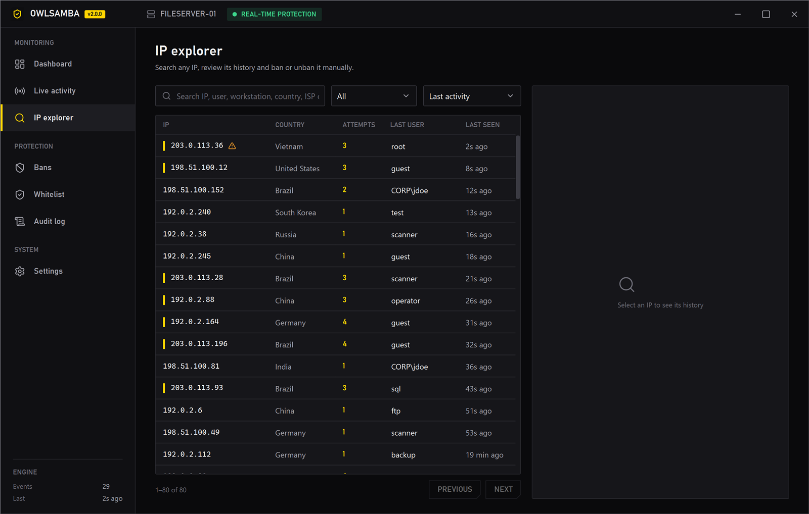
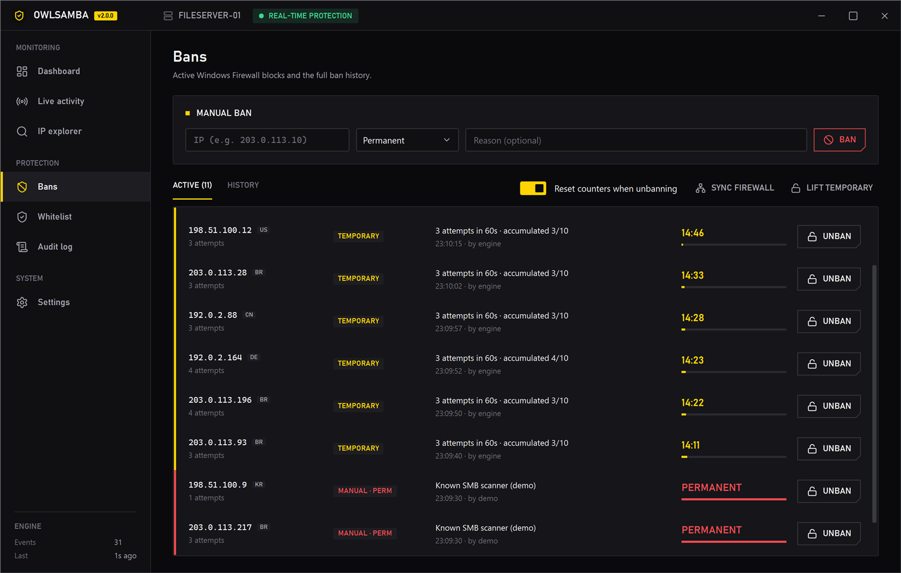
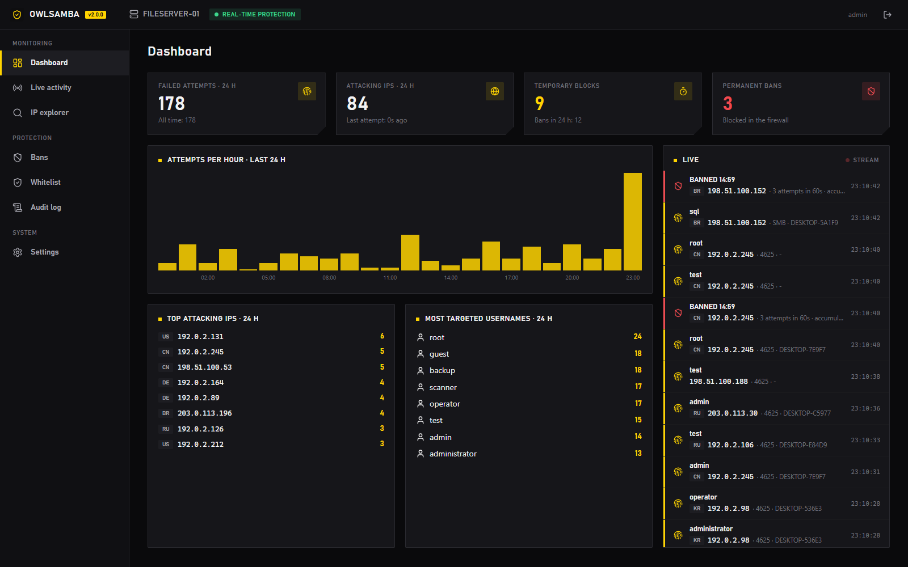
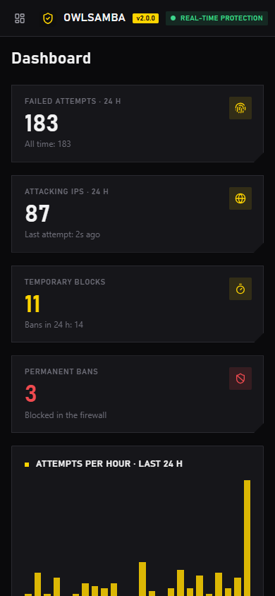
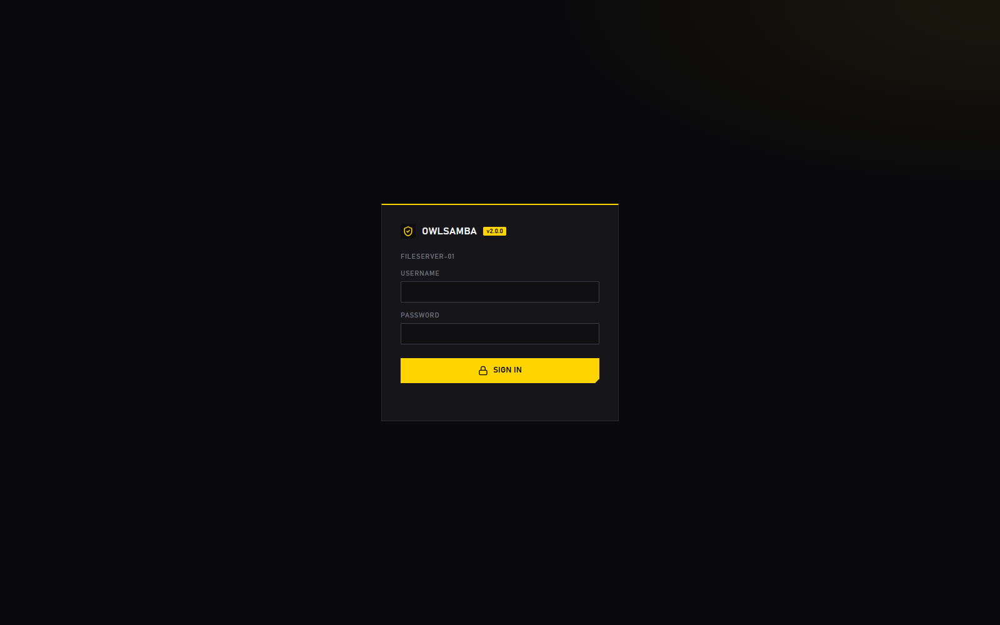

<p align="center"></p>

<h1 align="center">OwlSamba</h1>
<p align="center"><b>Real-time SMB brute-force protection for Windows</b><br>
One self-contained <code>.exe</code> · Windows service · desktop app · web dashboard</p>



OwlSamba watches failed Windows logons **as they happen** and blocks attacking IPs in Windows Defender Firewall within milliseconds. The previous version scanned the event log every 5 minutes, so an attacker with a list of 100 user/password pairs could finish the attack before the first scan. Version 2 subscribes to the event log directly, so the attacker is cut off after the 3rd failed try.

## How the ban policy works

| Rule | Default | What it means |
|---|---|---|
| Temporary block | **3** failures within **60 s** → blocked **15 min** | A password-spraying tool gets 3 tries, then it's blocked |
| Permanent ban | **10** accumulated attempts within **24 h** | Attempts keep adding up across temporary blocks |

With the defaults, a persistent attacker gets 3 tries every 15 minutes and is **banned forever on the 10th try, about 45 minutes into the attack**. Every value is configurable, and the Settings page shows what the current numbers mean in practice.

Other details:

- **Event sources:** Security log **4625** (failed logon) and **Microsoft-Windows-SMBServer/Security 551** (SMB authentication failure). A failure that is logged in both is counted once.
- **No polling:** OwlSamba uses `EventLogWatcher`, so Windows pushes each event to it the moment it is written.
- **Catch-up after a restart:** events written while the service was stopped are replayed from the last processed record, so nothing is missed.
- **Fast blocking:** bans go through the firewall COM API in-process (no `netsh` process to spawn). The IP's open **SMB sessions are closed** too, in case it already got in.
- **Breach alert:** if an IP with recent failures then **logs on successfully** (event 4624), OwlSamba raises an alert. It can also ban that IP automatically.
- **Audit policy:** failed-logon auditing is enabled automatically (without it, Windows never writes event 4625).
- **Trusted addresses:** loopback, the server's own IPs and the whitelist (IPs, CIDR ranges, domain names) are never banned.

## Features

- **Live activity:** every failed attempt streams to the desktop app and the web dashboard instantly, over Server-Sent Events.
- **IP explorer:** search any IP, user, workstation, country, ISP or note. Each IP shows its full attempt and ban history, and you can ban (15 min to permanent) or unban it, whitelist it, or attach notes.
- **Bans:** active bans with live countdowns, the full ban history, manual bans, "lift all temporary bans" and a one-click firewall resync.
- **Whitelist:** IPs, CIDR ranges and domains (domains are re-resolved every 10 minutes).
- **Audit log:** who banned, unbanned or changed settings, and when.
- **Notifications:** Discord webhooks (temporary bans, permanent bans, suspicious logons) and Windows tray notifications.
- **GeoIP:** country and ISP for each IP, from ip-api.com (can be turned off).
- **Data:** SQLite storage, CSV export (attempts, IPs, bans), backup and restore, a daily automatic backup and a configurable retention period.
- **Migration from v1:** imports the old `banned_ips.json` / `IP_History.json` (both formats), `DataBase.db`, and `.env` / `config.env`. It also replaces the old `SMB_block_*` firewall rules.
- **Web dashboard:** the same design for remote access from any browser or phone, over HTTPS with login. Failed dashboard logins feed the same brute-force engine.

| IP explorer | Bans |
|---|---|
|  |  |

| Web dashboard | Mobile | Login |
|---|---|---|
|  |  |  |

## Install

1. Download or build `OwlSamba.exe` (see [Build](#build)).
2. Run it and accept the UAC prompt. It needs administrator rights to read the Security log and manage the firewall.
3. Click **INSTALL & ENABLE**. OwlSamba then:
   - copies itself to `C:\Program Files\OwlSamba\OwlSamba.exe`,
   - registers the **OwlSamba** Windows service (automatic start, restarts itself on failure),
   - adds a Start menu shortcut,
   - and **migrates v1 data automatically** if it finds old files next to the exe.
4. Optional: open **Settings → Web dashboard** and set a password to enable remote access at `https://<server>:8443`.

Closing the window keeps OwlSamba in the system tray. Protection doesn't depend on the app: the service runs 24/7, even when nobody is signed in.

### Command line

```
OwlSamba.exe              desktop app (tray + window)
OwlSamba.exe --tray       desktop app, started hidden in the tray
OwlSamba.exe --install    install / upgrade the service and exit
OwlSamba.exe --uninstall  remove the service and exit
OwlSamba.exe --console    run the protection engine in a console (debugging)
```

### Upgrading from v1 (Python)

On first start, the service looks for v1 files next to the exe (and in a `backend` subfolder). To import from somewhere else, use **Settings → Migrate from OwlSamba v1** and pick the old folder. Each file is imported only once.

| v1 | v2 |
|---|---|
| `THRESHOLD` | permanent-ban threshold |
| `WHITELIST_IPS`, `WHITELIST_DOMAINS` | whitelist entries |
| `BAN_IPS` | "Block in Windows Firewall" |
| `DISCORD_WEBHOOK_URL` | Discord notifications |
| `DASHBOARD_USER`, `DASHBOARD_PASSWORD_HASH` | web dashboard login (bcrypt hashes are accepted and upgraded on first login) |
| banned IPs, plus IPs blocked by `SMB_block_*` / `SMB_block_V2_*` rules | permanent bans with new `OwlSamba Block <ip>` rules |

## Where things live

| Path | Contents |
|---|---|
| `C:\Program Files\OwlSamba\OwlSamba.exe` | installed program |
| `C:\ProgramData\OwlSamba\owlsamba.db` | SQLite database (IPs, attempts, bans, whitelist, settings, audit) |
| `C:\ProgramData\OwlSamba\logs\` | service logs (daily, 30 days) |
| `C:\ProgramData\OwlSamba\backups\` | daily automatic backups (last 7) and manual backups |
| Windows Firewall, group **OwlSamba** | `OwlSamba Block <ip>` rules and the `OwlSamba Dashboard` allow rule |

## Build

Requirements: Windows 10/11 or Server 2016+, and the [.NET 9 SDK](https://dotnet.microsoft.com/download).

```powershell
dotnet test                                          # unit tests (ban policy, parsing, migration)
dotnet publish src/OwlSamba -c Release -o publish    # → publish\OwlSamba.exe (single file, self-contained)
```

### Demo mode (no admin needed)

Debug builds run without elevation. The demo uses an in-memory firewall and sends simulated attacks from documentation IP ranges through the real detection engine:

```powershell
$env:OWLSAMBA_DATA_DIR = "$env:TEMP\owlsamba-demo"
dotnet run --project src/OwlSamba -- --console --demo   # protection engine + web dashboard on https://localhost:8443
dotnet run --project src/OwlSamba                       # desktop app (same OWLSAMBA_DATA_DIR)
```

## Architecture

```
OwlSamba.exe --service ──────────────────────────────────────────────────────────────┐
  EventLogWatcher (4625 · 551 · 4624) ─► BruteForceEngine ─► SQLite                     │
                                         │                 └► Windows Firewall (COM)    │
                                         └► LiveHub (SSE) ─► Discord / GeoIP            │
  Kestrel ─ 127.0.0.1:<random>  (desktop app, key in ProgramData, admins only)          │
          └ 0.0.0.0:8443 HTTPS  (web dashboard, cookie login)                           │
──────────────────────────────────────────────────────────────────────────────────────┘
OwlSamba.exe (WPF) ─► local API + live stream
```

- `src/OwlSamba/Detection`: event parsing, de-duplication, the ban engine, the event-log monitor.
- `src/OwlSamba/Data`: SQLite schema and queries (Dapper).
- `src/OwlSamba/Platform`: firewall, SMB session killer, audit policy, service installer.
- `src/OwlSamba/Server`: REST API, SSE stream, the embedded web dashboard (`wwwroot`).
- `src/OwlSamba/UI`: WPF desktop app (Corsair-style theme, [Lucide](https://lucide.dev) icons).

Icons: [Lucide](https://lucide.dev) (ISC license).
